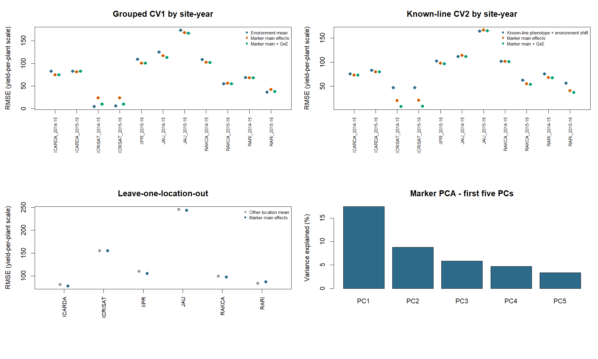

# Chickpea genomic prediction across seasons and locations

**R portfolio project · plant breeding and quantitative genetics · author: Sujan**


## What this project does

This repository contains two related analyses using public ICRISAT CicerSeq data. The two-season analysis models grain yield (GY) at ICRISAT in 2014–15 and 2015–16. A separate multi-location analysis models yield per plant using 11 site-year sheets from six locations, with `YPP` columns at most sites and `YPPlnt` at ICRISAT. The traits are analyzed separately; their raw scales are not pooled.

The two-season analysis covers 5,726 phenotype records from 2,926 marker-matched accessions, 2,800 of which were observed in both seasons. The multi-location analysis has 26,866 marker-matched records from 2,929 accessions after duplicate accession-by-site-year cells are averaged.

Two validation questions are asked, because they answer different breeding problems:

- **CV1 (new lines):** can we predict accessions that have no phenotype in training? Related accessions are kept together: ten marker-derived genetic clusters are held out whole.
- **CV2 (known lines, new season):** can we predict an accession's yield in one season when we already saw it in the other?

Models are ridge-regression genomic predictors with marker main effects and, in the cross-validation analyses, marker-by-environment interactions. The penalty is tuned inside each training set. The all-location holdout uses marker main effects without target-site fixed effects or target-site interactions.

## Status: revised analysis complete (2026-10-24)

The revised analyses were run in R 4.6.1. The two-season tables were regenerated from saved out-of-fold predictions. All-site CV and location-holdout summaries were independently checked against their saved prediction rows; the leave-one-season-out predictions are also saved and scored in `R/11_verify_saved_predictions.R`.

1. **The ridge penalty grid was too narrow.** Every v2.0 fold chose the largest value (1000). The revised grid spans 1 to 1e5; no two-season CV folds in this run selected an endpoint.
2. **The CV2 comparator was misleading.** The "known-line phenotype + environment shift" baseline is worse than the plain environment mean, because yield is only moderately repeatable between seasons. All gains are now reported against the environment mean, with the known-line baseline shown separately.
3. **Marker density is reported by season.** The revised results do not support a general claim that either the 195-marker or 955-marker panel is always better.
4. **The ridge implementation was cross-checked** against `rrBLUP::mixed.solve` (REML) on one representative grouped-CV1 fold; the comparison is in `reports/rrblup_crosscheck.csv`.

Run `Rscript run_genomic_prediction.R` from the repository root to rerun the analyses and regenerate reports and figures.

## Results

<!-- RESULTS:START -->

**Cross-validation (repeated 5-fold, 10 repeats).** Positive reduction means better than predicting the training-environment mean. The known-line baseline uses the accession's other-season phenotype plus an environment shift.

| Scenario | Season | Model | RMSE | Environment-mean RMSE | RMSE reduction vs environment mean (± SD) | Pearson r |
|---|---|---|---:|---:|---:|---:|
| CV1: new genetic clusters | ICRISAT_2014-15 | Marker main effects | 545.7 | 614.0 | 11.1% ± 0.4 | 0.385 |
| CV1: new genetic clusters | ICRISAT_2014-15 | Marker main + GxE | 546.3 | 614.0 | 11.0% ± 0.5 | 0.381 |
| CV1: new genetic clusters | ICRISAT_2015-16 | Marker main effects | 491.4 | 604.5 | 18.7% ± 0.7 | 0.501 |
| CV1: new genetic clusters | ICRISAT_2015-16 | Marker main + GxE | 490.1 | 604.5 | 18.9% ± 0.9 | 0.500 |
| CV2: known lines | ICRISAT_2014-15 | Marker main effects | 536.0 | 590.1 | 9.2% ± 0.1 | 0.421 |
| CV2: known lines | ICRISAT_2014-15 | Marker main + GxE | 535.7 | 590.1 | 9.2% ± 0.1 | 0.419 |
| CV2: known lines | ICRISAT_2014-15 | Known-line phenotype + environment shift | 625.7 | 590.1 | -6.0% ± 0.0 | 0.413 |
| CV2: known lines | ICRISAT_2015-16 | Marker main effects | 468.1 | 565.0 | 17.2% ± 0.1 | 0.564 |
| CV2: known lines | ICRISAT_2015-16 | Marker main + GxE | 466.9 | 565.0 | 17.4% ± 0.2 | 0.563 |
| CV2: known lines | ICRISAT_2015-16 | Known-line phenotype + environment shift | 625.8 | 565.0 | -10.8% ± 0.0 | 0.413 |

**Leave-one-season-out (same location, two years).**

| Direction | Training-season mean RMSE | Marker main RMSE | Reduction | Pearson r | Selected penalty |
|---|---:|---:|---:|---:|---:|
| ICRISAT_2014-15 to ICRISAT_2015-16 | 783.6 | 721.8 | 7.9% | 0.555 | 3162.27766016838 |
| ICRISAT_2015-16 to ICRISAT_2014-15 | 802.0 | 768.5 | 4.2% | 0.416 | 316.227766016838 |

**Marker-density sensitivity (grouped CV1, 3 repeats).**

| Season | Markers | RMSE (± SD) | Pearson r |
|---|---:|---:|---:|
| ICRISAT_2014-15 | 195 | 543.6 ± 1.2 | 0.393 |
| ICRISAT_2014-15 | 955 | 545.6 ± 2.7 | 0.392 |
| ICRISAT_2015-16 | 195 | 487.8 ± 0.8 | 0.513 |
| ICRISAT_2015-16 | 955 | 482.2 ± 2.2 | 0.531 |

- Season-to-season Pearson correlation of grain yield (paired accessions): **0.414**.
- Share of tuned ridge penalties at an edge of the grid (1 to 1e5): CV **0%**, marker-density runs **0%**. A high share means the grid is too narrow.
<!-- RESULTS:END -->

### All-site and independent-location results

Leave-one-location-out (LOLO) validation held out every year from each location. The comparator is the mean yield-per-plant value from the other locations. The marker model has no target-location effect. Values below are scored from saved held-out predictions.

| Held-out location | Records | Other-location mean RMSE | Marker RMSE | RMSE change vs mean | Pearson r |
|---|---:|---:|---:|---:|---:|
| ICARDA | 5,032 | 81.2 | 77.7 | 4.3% lower | 0.296 |
| ICRISAT | 5,687 | 155.1 | 155.1 | 0.0% higher | 0.096 |
| IIPR | 2,373 | 109.9 | 105.5 | 4.0% lower | 0.312 |
| JAU | 5,583 | 245.1 | 243.2 | 0.8% lower | 0.269 |
| RAKCA | 5,136 | 99.2 | 97.2 | 2.0% lower | 0.202 |
| RARI | 3,055 | 83.8 | 86.9 | 3.8% higher | 0.066 |

The marker model lowered RMSE at four of six held-out locations, but the gains were modest and correlations were weak at several sites. The workbook supports a within-dataset leave-one-location-out check, not a claim of robust performance at new breeding programs or future external trials. Locations share source-study context, and line overlap across locations means this is a transfer test for genotyped material rather than a completely independent population study.



RMSE is in the source grain-yield scale. `± SD` is the standard deviation across repeated random splits, not a confidence interval over breeding populations. Leave-one-season-out has one held-out season per direction, so it has no repeat-based SD.

## Data and provenance

Phenotypes and cultivated-panel HapMap markers are from the [ICRISAT CicerSeq data portal](https://cegresources.icrisat.org/cicerseq/?page_id=3444). The analysis reads `GY` from the `ICRISAT_2014-15` and `ICRISAT_2015-16` sheets of `3000_Phenotyping_data_QC.xlsx`. Raw files are downloaded at run time and are not redistributed; see [`data/raw/README.md`](data/raw/README.md). The [CicerSeq study](https://www.nature.com/articles/s41586-021-04066-1) is cited for context, not as evidence for results produced here.

For the two-season analysis, marker processing keeps every 500th row of each chromosome file, filters markers at MAF below 0.05 or above 20% missingness, and mean-imputes the rest (955 markers pass). Its compact panel takes every fifth QC-passed marker (195). The all-site analysis uses 953 QC-passed markers and every twentieth marker (50 total) for computational tractability. Both are fixed-stride samples, not full sequence-level analyses.

## Analysis design

1. **Quality checks:** workbook sheets and columns, normalized IDs, marker alignment, duplicate line-by-season cells, call rates, MAF, retained counts.
2. **Population structure:** genotype PCs and ten k-means clusters, formed without phenotypes.
3. **Nested tuning:** ridge penalty from a log-spaced grid (1 to 1e5) by three-fold inner CV within each outer training set, with grouped inner folds for CV1.
4. **Grouped CV1:** five-fold, ten repeats, whole clusters held out.
5. **CV2:** line-by-season cells held out while the line's other-season record stays in training.
6. **Leave-one-season-out:** train on one season, predict the other; no fixed effect is estimated from withheld data.
7. **Marker-density sensitivity:** grouped CV1 with the 195- and 955-marker panels (three repeats).
8. **Cross-check:** `rrBLUP::mixed.solve` on one representative CV1 fold against the hand-written ridge.
9. **All-site validation:** common yield-per-plant analysis across 11 site-year sheets; grouped CV1, known-line CV2, and leave-one-location-out across six locations. The location model has no target-site effect.
10. **Prediction verification:** rebuild scores from saved OOF predictions, export leave-one-season-out prediction rows, and verify the location-holdout and marker-density summaries.
11. **Reporting:** QC, fold-, repeat- and prediction-level results; figures and tables generated from saved summaries.

## Limits

- **Different validation scope.** The two-season analysis tests year transfer at ICRISAT. The separate six-location LOLO analysis is a within-workbook location holdout, not an external trial or future-location study.
- **Limited G×E evidence.** Two seasons and a fixed-season ridge interaction cannot support a full G×E analysis; a multi-location replicated trial is needed.
- **Weak and uneven location transfer.** LOLO lowered RMSE at four of six locations, by at most 4.3%; correlations were low at several sites and two locations were slightly worse than the other-location mean. Site-specific scales, management and line overlap limit interpretation.
- **Yield-column comparability.** The workbook labels the common yield-per-plant measure `YPP` outside ICRISAT and `YPPlnt` at ICRISAT. The analysis treats these as the same trait, but the source sheets show substantially different location scales; confirm units and trial protocols before pooling or operational use.
- **Uneven site coverage.** One location has only one recorded site-year, so its holdout represents one trial year.
- **Approximate relatedness control.** Clusters come from genotype PCs and k-means, not pedigree. Standardization, PCA and clustering use all lines (unsupervised, no phenotype), which is mild but real information sharing with test folds.
- **Sampled markers.** The panels come from a fixed-stride sample of the HapMap files, not the full marker set.
- **Phenotype precision.** Inputs are accession-level values as supplied; plot-level replication, blocks and field effects are not modeled.
- **Identifier matching.** Normalizing names can create false matches if source names are ambiguous.
- Results are exploratory and are not a cultivar recommendation.

## Run the project

R 4.1 or later. From the repository root:

```sh
Rscript run_genomic_prediction.R
```

The first run needs internet access (it downloads the workbook and eight chromosome files into `data/raw/`) and installs `readxl` and `rrBLUP` if missing. Figures use base R graphics. The wider penalty grid and all-site nested validation make a full run compute-intensive. Compressed out-of-fold predictions and other result tables are saved in `reports/`.

Data-independent tests (also run in GitHub Actions):

```sh
Rscript tests/test_validation_splits.R
Rscript tests/test_ridge_behavior.R
```

They check fold logic (clusters stay together; CV2 held-out cells keep the other season in training), ridge behaviour (a huge penalty collapses to the environment mean, a small one recovers signal) and grid-edge detection.

## Repository map

```text
R/05_genomic_prediction.R           one-season benchmark
R/06_multienvironment_validation.R  grouped CV1, CV2, G×season, leave-one-season-out, marker density
R/07_summarize_validation.R         rebuild repeat summaries from saved predictions
R/08_figures_and_tables.R           figures, results_table.md, README tables
R/09_rrblup_crosscheck.R            one-fold ridge versus rrBLUP::mixed.solve
R/10_all_site_validation.R          11 site-year sheets, six-location holdouts
R/11_verify_saved_predictions.R     prediction exports and summary checks
R/gxe_utils.R                       fold, ridge, grid and scoring helpers
run_genomic_prediction.R            complete entry point
reports/                            QC, metrics, folds, results tables
figures/                            two-season and all-site figures
tests/                              data-independent checks
```

## Citation

Varshney, R. K., Roorkiwal, M., Sun, S., et al. (2021). A chickpea genetic variation map based on the sequencing of 3,366 genomes. *Nature, 599*, 622–627. https://doi.org/10.1038/s41586-021-04066-1

Data portal: [ICRISAT CicerSeq](https://cegresources.icrisat.org/cicerseq/?page_id=3444). Cite the data source and study when using these data and follow the portal's usage request. Code is released under the MIT License; see [`CITATION.cff`](CITATION.cff).
