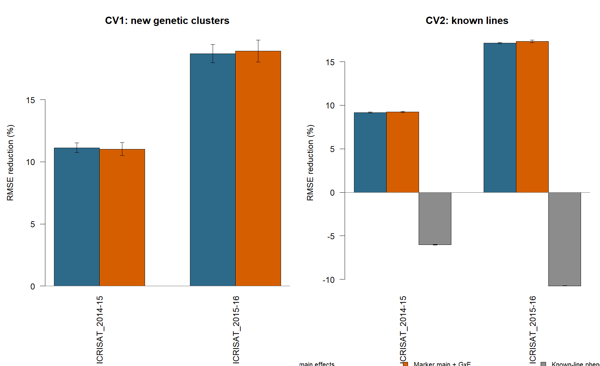

# Chickpea genomic prediction across seasons

**R portfolio project · plant breeding and quantitative genetics · author: Sujan**



## What this project does

It asks whether DNA marker data can predict chickpea grain yield (GY) better than a simple average, using public ICRISAT CicerSeq data from two seasons (2014–15 and 2015–16) at one location. The analysis covers 5,726 phenotype records from 2,926 marker-matched accessions, 2,800 of which were observed in both seasons.

Two validation questions are asked, because they answer different breeding problems:

- **CV1 (new lines):** can we predict accessions that have no phenotype in training? Related accessions are kept together: ten marker-derived genetic clusters are held out whole.
- **CV2 (known lines, new season):** can we predict an accession's yield in one season when we already saw it in the other?

Models are ridge-regression genomic predictors (equivalent to RR-BLUP with a fixed variance ratio) with marker main effects, and with marker-by-season interaction terms. The penalty is tuned by inner cross-validation inside every training set. The fair comparator throughout is the training-environment mean.

## Status: v2.1 code, results awaiting rerun

An internal review of v2.0 found problems that the v2.1 code fixes; the numbers below were produced by v2.0 and are provisional until the pipeline is rerun.

1. **The ridge penalty grid was too narrow.** Every tuned fold chose the largest value (1000), so the optimum lay outside the grid. v2.1 uses a log-spaced grid from 1 to 1e5 and warns when tuned penalties pile up at an edge.
2. **The CV2 comparator was misleading.** The "known-line phenotype + environment shift" baseline is worse than the plain environment mean, because yield is only moderately repeatable between seasons. All gains are now reported against the environment mean, with the known-line baseline shown separately.
3. **The marker-density claim is withdrawn.** The v2.0 finding that 195 markers matched or beat 955 is probably an artifact of the capped grid, since a larger panel needs a larger penalty. It is re-evaluated in v2.1.
4. **The hand-written ridge is now cross-checked** against `rrBLUP::mixed.solve` (REML) in `R/09_rrblup_crosscheck.R`, which also shows which penalty REML would choose.

After `Rscript run_genomic_prediction.R`, the tables below, `reports/results_table.md` and the figures are regenerated from the saved summaries.

## Results

<!-- RESULTS:START -->

> **Provisional: these are the v2.0 numbers, produced with a penalty grid that stopped at 1000 (every tuned fold chose 1000). They are replaced automatically when you rerun `Rscript run_genomic_prediction.R`.**

**Cross-validation (repeated 5-fold, 10 repeats).** Positive reduction means better than predicting the training-environment mean. The known-line baseline uses the accession's other-season phenotype plus an environment shift.

| Scenario | Season | Model | RMSE | Environment-mean RMSE | RMSE reduction vs environment mean (± SD) | Pearson r |
|---|---|---|---:|---:|---:|---:|
| CV1: new genetic clusters | ICRISAT_2014-15 | Marker main effects | 549.2 | 614.0 | 10.6% ± 0.5 | 0.376 |
| CV1: new genetic clusters | ICRISAT_2014-15 | Marker main + GxE | 550.0 | 614.0 | 10.4% ± 0.5 | 0.368 |
| CV1: new genetic clusters | ICRISAT_2015-16 | Marker main effects | 495.4 | 604.5 | 18.0% ± 0.9 | 0.485 |
| CV1: new genetic clusters | ICRISAT_2015-16 | Marker main + GxE | 498.4 | 604.5 | 17.5% ± 1.2 | 0.478 |
| CV2: known lines | ICRISAT_2014-15 | Marker main effects | 537.5 | 590.1 | 8.9% ± 0.1 | 0.419 |
| CV2: known lines | ICRISAT_2014-15 | Marker main + GxE | 537.8 | 590.1 | 8.9% ± 0.1 | 0.412 |
| CV2: known lines | ICRISAT_2014-15 | Known-line phenotype + environment shift | 625.7 | 590.1 | -6.0% ± 0.0 | 0.413 |
| CV2: known lines | ICRISAT_2015-16 | Marker main effects | 468.5 | 565.0 | 17.1% ± 0.1 | 0.560 |
| CV2: known lines | ICRISAT_2015-16 | Marker main + GxE | 470.0 | 565.0 | 16.8% ± 0.2 | 0.555 |
| CV2: known lines | ICRISAT_2015-16 | Known-line phenotype + environment shift | 625.8 | 565.0 | -10.8% ± 0.0 | 0.413 |

**Leave-one-season-out (same location, two years).**

| Direction | Training-season mean RMSE | Marker main RMSE | Reduction | Pearson r | Selected penalty |
|---|---:|---:|---:|---:|---:|
| ICRISAT_2014-15 to ICRISAT_2015-16 | 783.6 | 722.1 | 7.8% | 0.546 | 1000 |
| ICRISAT_2015-16 to ICRISAT_2014-15 | 802.0 | 770.0 | 4.0% | 0.413 | 100 |

**Marker-density sensitivity (grouped CV1, 3 repeats).** Not interpretable until the penalty grid is widened; see Status.

| Season | Markers | RMSE (± SD) | Pearson r |
|---|---:|---:|---:|
| ICRISAT_2014-15 | 195 | 550.1 ± 1.0 | 0.381 |
| ICRISAT_2014-15 | 955 | 579.0 ± 7.4 | 0.341 |
| ICRISAT_2015-16 | 195 | 491.1 ± 3.5 | 0.500 |
| ICRISAT_2015-16 | 955 | 508.5 ± 0.6 | 0.472 |

- Season-to-season Pearson correlation of grain yield (paired accessions): **0.413** (the known-line baseline's correlation in the v2.0 output).

<!-- RESULTS:END -->

RMSE is in the source grain-yield scale. `± SD` is the standard deviation across repeated random splits, not a confidence interval over breeding populations. Leave-one-season-out has one held-out season per direction, so it has no repeat-based SD.

## Data and provenance

Phenotypes and cultivated-panel HapMap markers are from the [ICRISAT CicerSeq data portal](https://cegresources.icrisat.org/cicerseq/?page_id=3444). The analysis reads `GY` from the `ICRISAT_2014-15` and `ICRISAT_2015-16` sheets of `3000_Phenotyping_data_QC.xlsx`. Raw files are downloaded at run time and are not redistributed; see [`data/raw/README.md`](data/raw/README.md). The [CicerSeq study](https://www.nature.com/articles/s41586-021-04066-1) is cited for context, not as evidence for results produced here.

Marker processing keeps every 500th row of each chromosome file, decodes biallelic calls, drops markers with MAF below 0.05 or more than 20% missing calls, and mean-imputes the rest (955 markers pass). The compact panel takes every fifth QC-passed marker (195). This is a tractable sample of the genome, not a full sequence-level analysis.

## Analysis design

1. **Quality checks:** workbook sheets and columns, normalized IDs, marker alignment, duplicate line-by-season cells, call rates, MAF, retained counts.
2. **Population structure:** genotype PCs and ten k-means clusters, formed without phenotypes.
3. **Nested tuning:** ridge penalty from a log-spaced grid (1 to 1e5) by three-fold inner CV within each outer training set, with grouped inner folds for CV1.
4. **Grouped CV1:** five-fold, ten repeats, whole clusters held out.
5. **CV2:** line-by-season cells held out while the line's other-season record stays in training.
6. **Leave-one-season-out:** train on one season, predict the other; no fixed effect is estimated from withheld data.
7. **Marker-density sensitivity:** grouped CV1 with the 195- and 955-marker panels (three repeats).
8. **Cross-check:** `rrBLUP::mixed.solve` on the first CV1 repeat against the hand-written ridge.
9. **Reporting:** QC, fold-, repeat- and prediction-level results; figures and tables generated from saved summaries.

## Limits

- **Two seasons, one location.** Leave-one-season-out tests year transfer at ICRISAT, not prediction at a new site.
- **Limited G×E evidence.** Two seasons and a fixed-season ridge interaction cannot support a full G×E analysis; a multi-location replicated trial is needed.
- **Approximate relatedness control.** Clusters come from genotype PCs and k-means, not pedigree. Standardization, PCA and clustering use all lines (unsupervised, no phenotype), which is mild but real information sharing with test folds.
- **Sampled markers.** The panels come from a fixed-stride sample of the HapMap files, not the full marker set.
- **Phenotype precision.** Inputs are accession-level values as supplied; plot-level replication, blocks and field effects are not modeled.
- **Identifier matching.** Normalizing names can create false matches if source names are ambiguous.
- Results are exploratory and are not a cultivar recommendation.

## Run the project

R 4.1 or later. From the repository root:

```sh
Rscript run_genomic_prediction.R
```

The first run needs internet access (it downloads the workbook and eight chromosome files into `data/raw/`) and installs `readxl`, `ggplot2` and `rrBLUP` if missing. The wider penalty grid makes the run noticeably slower than v2.0. Out-of-fold predictions are saved compressed in `reports/` and are not tracked by git.

Data-independent tests (also run in GitHub Actions):

```sh
Rscript tests/test_validation_splits.R
Rscript tests/test_ridge_behavior.R
```

They check fold logic (clusters stay together; CV2 held-out cells keep the other season in training), ridge behaviour (a huge penalty collapses to the environment mean, a small one recovers signal) and grid-edge detection.

## Repository map

```text
R/05_genomic_prediction.R           one-season benchmark
R/06_multienvironment_validation.R  grouped CV1, CV2, G×season, leave-one-season-out, marker density
R/07_summarize_validation.R         rebuild repeat summaries from saved predictions
R/08_figures_and_tables.R           figures, results_table.md, README tables
R/09_rrblup_crosscheck.R            hand-written ridge versus rrBLUP::mixed.solve
R/gxe_utils.R                       fold, ridge, grid and scoring helpers
run_genomic_prediction.R            complete entry point
reports/                            QC, metrics, folds, results tables
figures/                            summary figures
tests/                              data-independent checks
```

## Citation

Varshney, R. K., Roorkiwal, M., Sun, S., et al. (2021). A chickpea genetic variation map based on the sequencing of 3,366 genomes. *Nature, 599*, 622–627. https://doi.org/10.1038/s41586-021-04066-1

Data portal: [ICRISAT CicerSeq](https://cegresources.icrisat.org/cicerseq/?page_id=3444). Cite the data source and study when using these data and follow the portal's usage request. Code is released under the MIT License; see [`CITATION.cff`](CITATION.cff).
